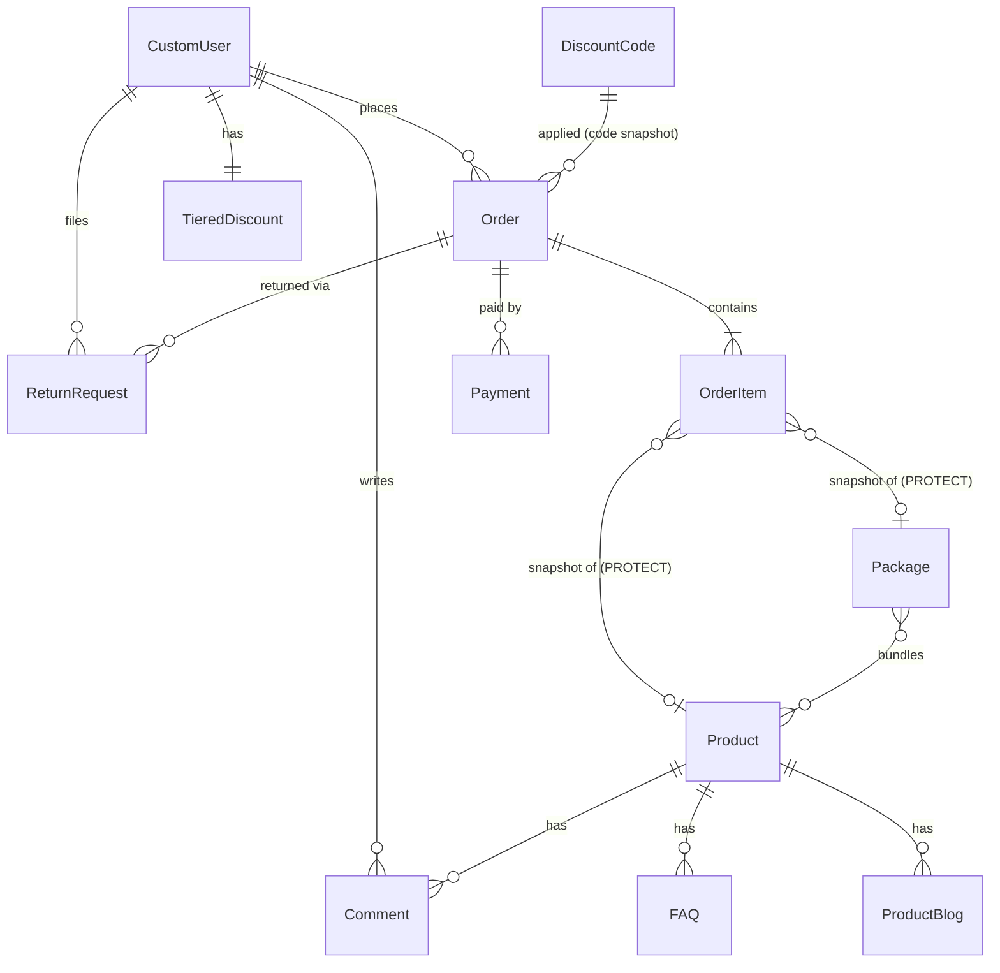
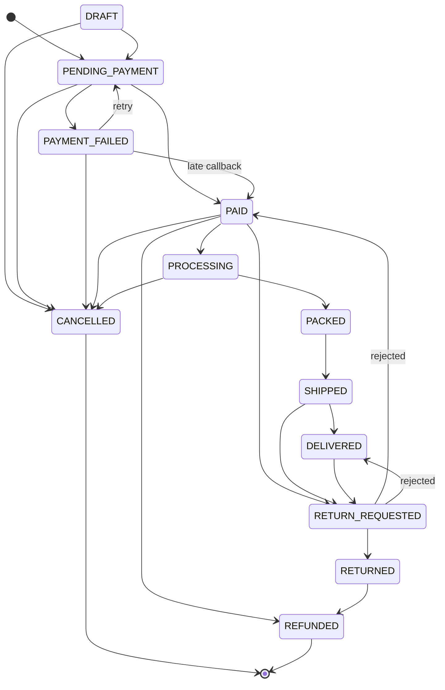

# Kasra Publishing — Master Architecture & Implementation Plan

> این سند نقشهٔ معماری و اجرای پلتفرم فروش و انتشار «نشر کسری» (ناشر تخصصی کتاب معماری) است.
> توضیحات فارسی، نام‌های فنی و کد انگلیسی. هر تغییر باید با معماری فعلی سازگار باشد:
> **No Feature Creep · No Unnecessary Refactoring · No Random Architecture Changes.**

---

## 1. تصمیم معماری اصلی: Django Modular Monolith

| گزینه | وضعیت |
|---|---|
| Django 6 + DRF + PostgreSQL (فعلی) | **حفظ می‌شود** |
| بازنویسی با FastAPI / Next.js / Microservices | رد شد |

**دلیل فنی:**

1. کد فعلی (کاتالوگ، سبد، سفارش، پرداخت، حساب کاربری، ادمین، ترجمهٔ فارسی، داده‌های import‌شده از WordPress) روی Django کار می‌کند؛ بازنویسی یعنی شکستن رفتار موجود.
2. Django Admin جایگزین ارزانِ پنل مدیریت (CMS، سفارش‌ها، مرجوعی، کدهای تخفیف) است.
3. ترافیک یک ناشر تخصصی نیاز به Microservice ندارد؛ Modular Monolith با مرز ماژول‌های مشخص، هزینهٔ عملیاتی کمتر و تراکنش دیتابیسی واحد (برای موجودی + پرداخت) دارد.
4. API موجود (`/api/v1/`) برای اپ موبایل یا frontend جدا در آینده کافی است؛ اگر روزی Next.js لازم شد، فقط لایهٔ نمایش عوض می‌شود.

---

## 2. مرز ماژول‌ها (Module Boundaries)

اپ‌های فعلی Django به ماژول‌های هدف نگاشت شده‌اند. ماژول‌های «جدید» فقط در فاز مربوط ساخته می‌شوند.

| ماژول هدف | اپ فعلی | مسئولیت | وضعیت |
|---|---|---|---|
| **Catalog** | `products` | Product (کتاب)، Package، Comment، FAQ، ProductBlog، جستجو | موجود؛ Work/Edition در Phase 1 |
| **Commerce** | `cart`, `orders`, `payment` | سبد session، Order + State Machine، Payment، ReturnRequest | موجود و سخت‌سازی شد |
| **Promotions** | `products` (DiscountCode, TieredDiscount, InstallmentPlan) | کد تخفیف، تخفیف پلکانی | موجود؛ اقساط فقط UI |
| **Inventory** | فیلد `stock` روی Product/Package | موجودی | Ledger در Phase 1 |
| **Identity** | `accounts` (CustomUser)، allauth، simplejwt | ورود، پروفایل، کیف پول، JWT | موجود؛ RBAC در Phase 1 |
| **Content** | `pages`, `persian_translate` | صفحات ثابت، درباره ما، تماس، شرایط | موجود |
| **Notifications** | `services/sms.py` (Kavenegar) | پیامک سفارش/مرجوعی | موجود؛ NotificationService در Phase 2 |
| **Platform / Core** | `core`, `api` | نرمال‌سازی فارسی، ISBN، Health Check، Error Envelope | جدید (این مرحله) |
| **Publishing** | — | گردش کار تولید کتاب (manuscript → print) | Phase 3 |
| **CRM / Reporting** | — | گزارش فروش، مشتریان | Phase 3 |

**قاعدهٔ وابستگی:** `core` به هیچ اپی وابسته نیست. `payment` → `orders` → `products`. منطق تجاری در `services.py` هر اپ است، نه در view.

---

## 3. ERD (وضعیت فعلی)



**نکات کلیدی schema:**

- `Order.user`, `OrderItem.product`, `OrderItem.package`, `Payment.order` → `on_delete=PROTECT`. حذف کتاب دیگر تاریخچهٔ سفارش را پاک نمی‌کند.
- `OrderItem.title` و `OrderItem.price` snapshot زمان خرید هستند.
- `Payment.reference` (UUID, unique) شناسهٔ ResNum درگاه است.
- Constraintها: `payment_unique_gateway_transaction` (یک تراکنش بانکی فقط یک بار)، `payment_one_paid_per_order` (هر سفارش حداکثر یک پرداخت موفق).
- مبالغ در دیتابیس **تومان** هستند؛ درگاه SEP **ریال** می‌خواهد (`PAYMENT_AMOUNT_MULTIPLIER = 10`).

---

## 4. State Machineها

### 4.1 Order (`orders/models.py → Order.TRANSITIONS`)



تغییر وضعیت فقط از طریق `order.transition_to(status)` مجاز است؛ انتقال نامعتبر `InvalidOrderTransition` می‌دهد. اکشن‌های ادمین (`mark_processing`, `mark_shipped`, …) با `select_for_update` همین متد را صدا می‌زنند.

### 4.2 Payment (`payment/models.py`)

`INITIATED → PENDING → PAID | FAILED | CANCELLED`

### 4.3 جریان پرداخت SEP (`payment/services.py`)

1. `start_payment`: قفل سفارش، ساخت `Payment` با `reference` یکتا، درخواست token (خارج از transaction).
2. کاربر به `sep.shaparak.ir` می‌رود.
3. Callback (cross-site POST، **بدون session**) → `handle_callback` پرداخت را با `ResNum` پیدا می‌کند، نه با session.
4. Idempotency: callback تکراری برای پرداخت PAID فقط success برمی‌گرداند و موجودی را دوباره کم نمی‌کند.
5. قبل از verify، موجودی با `select_for_update` (به ترتیب pk برای جلوگیری از deadlock) چک می‌شود؛ اگر کافی نباشد verify انجام نمی‌شود و بانک خودکار برگشت می‌زند.
6. مبلغ verify‌شده با مبلغ سفارش مقایسه می‌شود؛ مغایرت → FAILED + `reverse` بعد از commit.
7. موفقیت → کاهش موجودی با `F()`، وضعیت PAID، افزایش `used_count` کد تخفیف، به‌روزرسانی TieredDiscount، پیامک در `on_commit`.

---

## 5. API Architecture

- نسخه‌بندی: `/api/v1/` (اصلی) و `/api/` (deprecated، برای سازگاری).
- Auth: JWT (`simplejwt` + `token_blacklist`) و Session. BasicAuthentication حذف شد.
- Throttling: anon/user (در تست غیرفعال).
- مستندات: `/api/v1/swagger/` و `/api/v1/redoc/` (drf_yasg).
- **Error Envelope استاندارد** (`api/exceptions.py`):

```json
{"success": false, "error": {"code": "VALIDATION_ERROR", "message": "...", "details": {}}}
```

کدهای پایه: `VALIDATION_ERROR`, `NOT_AUTHENTICATED`, `PERMISSION_DENIED`, `NOT_FOUND`, `METHOD_NOT_ALLOWED`, `RATE_LIMITED`. خطاهای دامنه با `APIError(code, message)` (مثلاً `BOOK_OUT_OF_STOCK`, `INVALID_QUANTITY`).

---

## 6. Search (فارسی)

`core/text.py → normalize_persian`: یکسان‌سازی ي/ك، ة/ۀ، أ/إ، ارقام فارسی/عربی، حذف اعراب و کشیده، ZWNJ و علائم → فاصله.
`products/search.py`: هر توکن (حداکثر ۶) باید پیدا شود (AND)؛ هر توکن در هر فیلد (OR) با واریانت‌های املایی.
**Phase 1:** ستون `search_document` نرمال‌شده + PostgreSQL FTS و `pg_trgm`.

## 7. ISBN

`core/isbn.py`: اعتبارسنجی checksum برای ISBN-10/13 و تبدیل canonical به ISBN-13. `Product.clean()` ISBN نامعتبر و تکراری (حتی ISBN-10 در برابر ISBN-13 معادل) را رد می‌کند.
**Phase 1:** ستون `isbn13` با unique index بعد از پاک‌سازی داده‌های import‌شده.

## 8. Inventory Ledger (طرح Phase 1)

```
StockTransaction(product|package, type=PURCHASE|SALE|RETURN|ADJUSTMENT|RESERVE|RELEASE,
                 quantity(+/-), order?, user?, note, created_at)
```

`Product.stock` به‌صورت cache نگه داشته می‌شود و فقط از طریق service ledger تغییر می‌کند (`F()` + ثبت تراکنش در یک atomic). رزرو موجودی با انقضا جایگزین `reserve_stock` بلااستفادهٔ فعلی می‌شود.

## 9. Security

- Secretها فقط از env (`.env.example`)؛ `config/settings_production.py`: `DEBUG=False`، SSL redirect، HSTS، Secure/SameSite cookies، `X_FRAME_OPTIONS=DENY`.
- debug_toolbar فقط در `DEBUG and not TESTING`.
- API: کاربر نمی‌تواند نظر خود را approve کند، روی سفارش دیگران مرجوعی ثبت کند یا `status/admin_note` مرجوعی را تغییر دهد.
- هشدار موجود: `django-ckeditor` (CKEditor 4) دیگر پشتیبانی امنیتی ندارد → Phase 2: مهاجرت به `django-ckeditor-5` یا `django-prose-editor`.

## 10. Observability & Deployment

- `/health/` → `{"status": "PASS|FAIL", "checks": {"database": ..., "cache": ...}}` با 200/503.
- LOGGING کنسول؛ Redis cache اگر `REDIS_URL` تنظیم باشد.
- `Dockerfile.prod` (non-root، compilemessages، collectstatic) + `docker-compose.prod.yml` (migrate قبل از gunicorn، healthcheck) + nginx (gzip، security headers؛ TLS هنوز TODO).

---

## 11. یافته‌های بازبینی (این مرحله)

### رفع شده

| مشکل | اثر |
|---|---|
| Callback درگاه به session وابسته بود | پرداخت موفق در مرورگرهای جدید (SameSite) ثبت نمی‌شد |
| مبلغ به تومان به SEP ارسال می‌شد | دریافت یک‌دهم مبلغ |
| فیلدهای API درگاه SEP اشتباه بود | token/verify کار نمی‌کرد |
| نبود idempotency در callback | کسر دوبارهٔ موجودی و تخفیف پلکانی با replay |
| مبلغ verify چک نمی‌شد | پرداخت ناقص = سفارش پرداخت‌شده |
| موجودی Package منفی می‌شد | فروش بیش از موجودی |
| حذف کتاب → حذف آیتم‌های سفارش (CASCADE) | از دست رفتن تاریخچهٔ مالی |
| باگ `or` در جمع کل با تخفیف ۱۰۰٪ | مبلغ صفر نادیده گرفته می‌شد |
| API: approve نظر توسط خود کاربر، مرجوعی روی سفارش دیگران | نقص امنیتی |
| CartAPI با quantity نامعتبر 500 می‌داد | crash |
| `stars` نامعتبر در فرم نظر → 500 | crash |
| PackageSerializer → `avg_rating` ناموجود | `/api/v1/packages/` 500 می‌داد |
| JSON-LD قیمت تومان را IRR اعلام می‌کرد | دادهٔ ساختاریافتهٔ غلط برای گوگل |
| نبود `settings_production`، نام env متفاوت در docker | deploy خراب |
| `token_blacklist` نصب نبود | logout JWT بی‌اثر |

### باقی‌مانده (در کد با `TODO(Phase N - Area)` علامت خورده‌اند)

- Work/Edition و Contributor (فیلد `edition` در واقع مترجم را نگه می‌دارد؛ `author` رشتهٔ CSV است).
- Inventory Ledger و رزرو موجودی.
- AuditLog برای اکشن‌های ادمین.
- Refund، لغو سفارش پرداخت‌شده با بازگشت موجودی، Shipment.
- Address snapshot و تفکیک subtotal/discount/shipping.
- پرداخت اقساطی فقط UI است؛ سفارش اقساطی کل مبلغ را آنلاین پرداخت می‌کند.
- Verified reviews، URL مبتنی بر slug.
- Migration drift موجود از قبل: `products 0013 (alter category)` — ساخته نشده؛ بعد از بررسی choices دسته‌ها با `makemigrations products` ساخته شود.

---

## 12. Phase 1 — تسک‌های کوچک

| # | تسک | ماژول | وضعیت |
|---|---|---|---|
| 1.1 | Payment model + Gateway abstraction (SEP) + idempotent callback | Commerce | ✅ انجام شد |
| 1.2 | Order State Machine + snapshot + PROTECT | Commerce | ✅ انجام شد |
| 1.3 | Error envelope + `/api/v1/` + throttling + رفع مجوزهای API | API | ✅ انجام شد |
| 1.4 | نرمال‌سازی فارسی جستجو | Catalog | ✅ انجام شد |
| 1.5 | اعتبارسنجی ISBN در `Product.clean()` | Catalog | ✅ انجام شد |
| 1.6 | Health check + settings_production + Docker | Platform | ✅ انجام شد |
| 1.7 | پاک‌سازی ISBNهای تکراری + ستون `isbn13` unique | Catalog | ⏳ بعدی |
| 1.8 | `StockTransaction` ledger + سرویس موجودی | Inventory | ⏳ |
| 1.9 | رزرو موجودی با انقضا در checkout | Inventory | ⏳ |
| 1.10 | `AuditLog` (user, action, old/new, IP) برای اکشن‌های ادمین | Platform | ⏳ |
| 1.11 | RBAC با Django Groups (Admin, Editor, Warehouse, Support, Accountant) | Identity | ⏳ |
| 1.12 | `search_document` + PostgreSQL FTS / pg_trgm | Catalog | ⏳ |
| 1.13 | Work / Edition / Contributor (migration داده با حفظ URLهای فعلی) | Catalog | ⏳ |
| 1.14 | URL slug با 301 از URL قدیمی | SEO | ⏳ |

**Definition of Done هر تسک:** migration برگشت‌پذیر، تست واحد + یکپارچه، ترجمهٔ فارسی (`django.po`)، عدم شکستن رفتار قبلی، اجرای کامل test suite.

---

## 13. دستورات

```powershell
# migrationهای جدید: orders 0008، payment 0001، token_blacklist
python manage.py migrate

# ترجمه‌ها
python manage.py compilemessages -l fa --ignore venv

# تست‌های مرتبط با این مرحله
python manage.py test payment orders api core products

# کل test suite  (انتظار: Ran 168 tests ... OK)
python manage.py test

# بررسی تنظیمات production
python manage.py check --deploy --settings=config.settings_production
```
